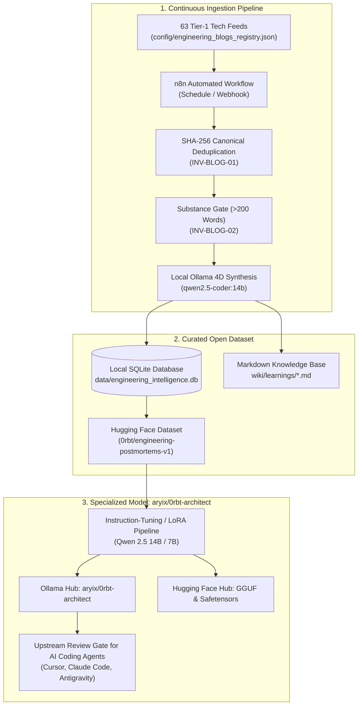

<div align="center">

# 🪐 0rbt (Orbit)
### Open-Source Engineering Architecture Intelligence & Decision Engine

[](https://opensource.org/licenses/Apache-2.0)
[](https://www.python.org/)
[](https://ollama.com/)
[](https://ollama.com/)
[](CONTRIBUTING.md)

**Assist AI coding agents and software engineers in making battle-tested architectural decisions by learning directly from premier engineering organizations.**

[Quickstart](#-quickstart-in-30-seconds) •
[The 3 Pillars](#-the-3-pillars-of-0rbt) •
[CLI Reference](#-cli-reference) •
[Curated Dataset](#-the-curated-dataset) •
[Contributing](CONTRIBUTING.md)

</div>

---

## ⚡ The Problem

Today, AI coding assistants (Cursor, Claude Code, GitHub Copilot, Windsurf) excel at writing individual functions and scripts, but **frequently make catastrophic architectural decisions** when architecting distributed backends:
* They recommend premature microservices that collapse under latency cascades.
* They omit idempotency keys on payment endpoints, causing double-charge race conditions.
* They forget distributed lock expiration (TTL) and monotonic fencing tokens.
* They over-engineer simple seed startups with massive Kafka and Kubernetes clusters.

Meanwhile, premier engineering teams (**Netflix, Stripe, Uber, Google, Meta, GitHub, Datadog, Cloudflare, AWS**) have already solved these exact architectural dilemmas and published their failure root causes, trade-offs, and resilience patterns in post-mortems.

**`0rbt` harvests, synthesizes, and models this collective engineering intelligence** so that developers and AI agents can query battle-tested answers at $0 cloud token cost.

---

## 🚀 Quickstart in 30 Seconds

### Option 1: Run the Specialized Model via Ollama
You can run the specialized Principal Architect model locally:

```bash
# Pull and run the specialized architecture model
ollama run aryix/0rbt-architect
```

Ask it any complex system design problem:
> *"We are building a payment webhook gateway processing 500 req/sec. How should we handle retries, network partitions, and idempotency at small scale without enterprise microservices?"*

---

### Option 2: Query the Local Knowledge Base (RAG)
Clone this repository and query the local SQLite vector database:

```bash
# 1. Clone the repository
git clone https://github.com/aryix-hq/0rbt.git
cd 0rbt

# 2. Pull local models for inference & embeddings ($0 cost)
ollama pull qwen2.5-coder:14b
ollama pull nomic-embed-text

# 3. Ask the engineering blogs directly
python3 bin/eng-intelligence.py ask "How does Netflix prevent telemetry storage explosion in distributed tracing?"
```

---

## 🏛 The 3 Pillars of 0rbt



### Pillar 1: Ingestion & Pipeline
* Continuously monitors **63 verified engineering blogs** (Google, Netflix, Stripe, Uber, Meta, GitHub, Datadog, AWS, Cloudflare, Spotify, Slack, etc.).
* Automated n8n workflow canvas ([`n8n/engineering_blogs_pipeline.json`](n8n/engineering_blogs_pipeline.json)) with deterministic SHA-256 deduplication and noise filtering.
* Extracts a **4-Dimensional Synthesis Matrix**:
  1. **LinkedIn Thought Leadership**: 3 contrarian/narrative/practical hooks + 4-slide carousel outline.
  2. **Enterprise Architecture**: Exact pattern, failure root-cause, system invariants, and trade-offs.
  3. **Small-Scale Client Playbook**: "Big Tech $\to$ Lean Startup" translation (Postgres/Redis alternatives saving \$2k–\$8k/mo).
  4. **AI Invariant Rules**: Production invariant rules for agentic systems.

### Pillar 2: Curated Open Dataset
* **4,169 verified engineering articles** and **11,936 architecture diagrams** spanning 10+ years across 63 premier technology organizations.
* **5,508 instruction-tuning pairs** (`dataset/instruction_tuning_v1.jsonl`) combining empirical post-mortems, 20 Anti-Vibe Invariants, and the complete 250+ `ai-agents` skills suite (including 78 Red Team offensive skills and 35 Bug Hunter validation gates).
* Formatted in clean ChatML and tabular JSONL for research, retrieval, and fine-tuning.

### Pillar 3: The Specialized Model (`aryix/0rbt-architect`)
* **Dual-Hat Architect & Red Team Persona**: Unified Staff Systems Architect and Adversarial Red Team Lead.
* **Phase A (Ollama Modelfile)**: Bundled system persona, retrieval reasoning instructions, 20 anti-vibe engineering invariants, adversarial cloud/container exploit defense, and the 7-Question Validation Gate.
* **Phase B (Fine-Tuned Adapter)**: Specialized LoRA adapter trained on failure diagnosis and penetration testing pairs.

---

## 💻 CLI Reference

The zero-token CLI (`bin/eng-intelligence.py`) provides instant local management:

```bash
# Initialize local SQLite persistence
python3 bin/eng-intelligence.py init

# Ask local LLM an architectural question (uses vector search + qwen2.5-coder:14b)
python3 bin/eng-intelligence.py ask "How can I prevent double charges in my API at small scale?"

# Ingest and synthesize any article URL on demand
python3 bin/eng-intelligence.py ingest "https://stripe.com/blog/engineering/designing-robust-idempotent-apis"

# View summary metrics of indexed companies, patterns, and savings
python3 bin/eng-intelligence.py stats

# List all indexed architectural patterns
python3 bin/eng-intelligence.py list

# Run deterministic verification test suite
python3 bin/eng-intelligence.py mock-test
```

---

## 📊 Sample 4D Synthesis Output

When an article like *Stripe: Designing Robust Idempotent APIs* is processed, `0rbt` extracts:

```markdown
# Stripe: Designing Robust Idempotent APIs

## 1. Problem & Root Cause
Preventing double charges in payment systems due to transient network timeouts and race conditions.

## 2. Big Tech vs. Lean Startup Client Playbook
- Big Tech Overkill: Do NOT build custom multi-cluster consensus engines.
- Pragmatic Small-Scale: Implement an idempotency table in PostgreSQL with a UNIQUE constraint, paired with a short-lived Redis distributed mutex (TTL 10s). Replay saved HTTP status and JSON response for duplicate keys.
- Estimated Savings: Eliminates manual transaction reconciliations and chargeback fees ($3,000+/mo).

## 3. LinkedIn Content Drafts
- Hook (Contrarian): "Stripe's solution to double charges is not just about locking; it's about making mutations idempotent at the database constraint level."
- Hook (Narrative): "When a customer payment times out, 40% of users hit 'Pay' again. Here is how Stripe guarantees you only charge once..."

## 4. ai-agents Invariant Rule
- Rule: INV-SEC-09: Mutating payment and billing endpoints must require client-supplied Idempotency-Key headers with atomic DB constraint deduplication.
```

---

## 🧪 Testing & Invariant Verification

`0rbt` enforces zero-mock regression testing across all invariant linters:

```bash
# 1. Test pipeline invariants & JSON schemas
python3 bin/test-blog-pipeline.py

# 2. Run Google OSS-inspired Invariant Mutation Fuzzer (100% kill rate)
python3 bin/invariant-fuzzer.py --mock-test

# 3. Run Two-Axis Code Reviewer (Standards vs Spec Isolation)
python3 bin/two-axis-reviewer.py --base main
```

---

## 🤝 Contributing

We welcome community contributions! You can help by:
- Adding new company engineering feeds to [`config/engineering_blogs_registry.json`](config/engineering_blogs_registry.json).
- Enhancing historical sitemap scrapers in `bin/`.
- Contributing architectural benchmark questions.

Check out our [Contributing Guide](CONTRIBUTING.md) to get started.

---

## 📄 License

* Software & Pipeline: [Apache 2.0 License](LICENSE)
* Curated Dataset: [CDLA-Permissive-2.0](https://cdla.dev/permissive-2-0/)
* Models: Open Weights under [Qwen Community License](https://github.com/QwenLM/Qwen2.5/blob/main/LICENSE)
