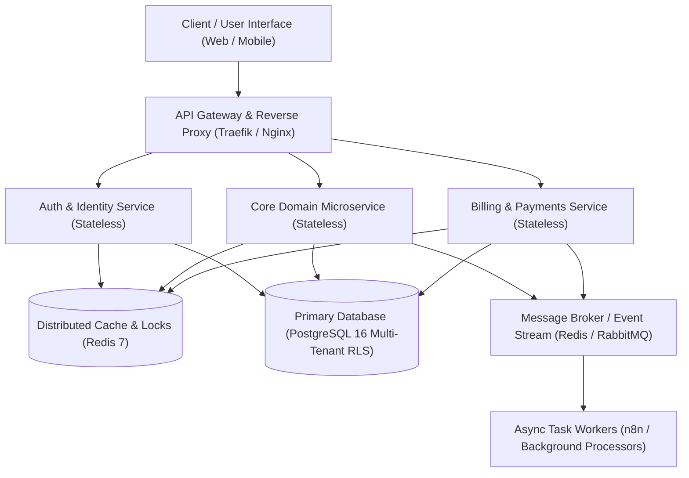

# Living System Architecture

> **Custodian**: System Architect & Staff Engineer (`@architect`)  
> **Status**: Living Architectural Specification  
> **Last Synchronized**: 2026-10-21  

This document serves as the single source of truth for high-level system topology, domain boundaries, data pipelines, API contracts, and trade-offs.

---

## 1. System Topology Overview (Stateless Microservices)

---

## 2. Core Architectural & Defensive Invariants
1. **100% Stateless Compute Tiers**: Compute nodes store zero in-memory session or user state. All state externalizes to PostgreSQL 16 (connection pooled) and Redis 7 (locks, idempotency, sessions).
2. **Layered Separation of Concerns**: Strict Controller $\to$ Service $\to$ Repository decoupling. Business logic, UI, and raw SQL queries never intermingle.
3. **Strict API Contracts & Versioning**: Cross-service and client boundaries communicate via versioned endpoints (`/api/v1/`) with typed Request/Response DTOs and OpenAPI specifications.
4. **Mandatory Idempotency**: State mutations (`POST`, `PUT`, `PATCH`) require `Idempotency-Key` headers to protect against network retries and duplicate charges.
5. **Runtime Boundary Validation**: Ingress payloads must validate against strict schemas (Zod/Pydantic) before business logic execution.
6. **BOLA / IDOR Defense**: All tenant data operations enforce `WHERE id = :id AND tenant_id = :tenant_id`.
7. **Local-First & Ephemeral Previews**: Entire microservices topology runs locally via Docker and verifies cleanly via `bin/deploy-preview.sh`.
8. **Polyglot Persistence & Transactional Outbox**: Enforce PostgreSQL 16 RLS for relational ledgers, Redis 7 for caching and distributed locks, and the Transactional Outbox pattern for decoupled event streaming (Kafka/RabbitMQ/Redis Streams).
9. **Dual-Scale Sizing Profile**: Architecture must run identically in two operational profiles: Small-Scale (<2GB RAM on developer laptop / self-managed VPS via Docker Compose & Redis Streams) and Enterprise-Scale (Kubernetes, Kafka cluster, PostgreSQL HA, and OpenTelemetry collector) with zero code modifications.

---

## 3. Architecture Decision Records (ADR Index)

All structural changes to schemas, frameworks, or security boundaries must be debated via `@orchestrator-debate` and recorded in `wiki/adr/`:

| ADR ID | Title | Status | Date | Decision Summary |
| :--- | :--- | :--- | :--- | :--- |
| [`ADR-001`](./adr/ADR-001.md) | Modular Monolith & Postgres RLS | Accepted | 2026-10-17 | Enforce tenant isolation via PostgreSQL RLS |
| [`ADR-002`](./adr/ADR-002.md) | Stateless Microservices & Anti-Vibe Coding | Accepted | 2026-10-21 | Mandate stateless compute, idempotency, boundary validation & BOLA defense |
| [`ADR-003`](./adr/ADR-003.md) | Dual-Scale Architecture & Observability | Accepted | 2026-10-21 | Enforce polyglot persistence, OTel traceability, and laptop-to-cloud dual-scale sizing |

