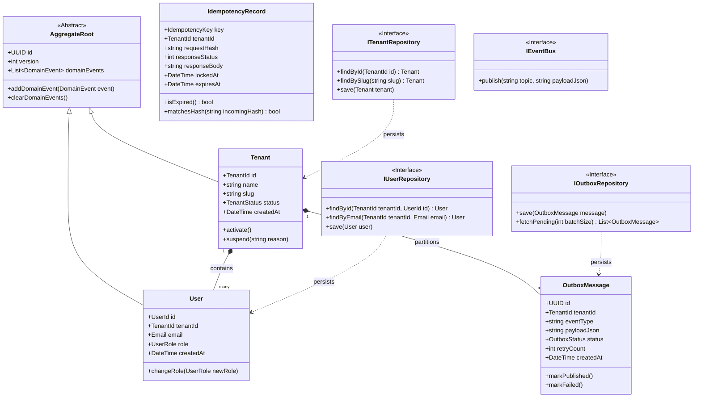
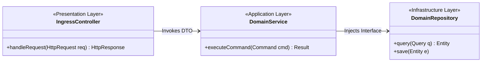

# Living Domain Models & Class Specifications

> **Custodian**: Core Software Engineer & Staff Architect (`@fullstack-developer`, `@architect`)  
> **Status**: Living Domain Specification  
> **Last Synchronized**: 2026-10-21  

This document serves as the living source of truth for all domain entities, value objects, aggregate roots, service interfaces, and repository contracts across the codebase.

---

## 1. Domain Entities & Class Hierarchy

---

## 2. Layered Clean Architecture Decoupling

---

## 3. Core Value Object Invariants
1. **Immutability**: All Value Objects (`TenantId`, `UserId`, `Email`, `Money`, `IdempotencyKey`) are strictly immutable and validated at construction.
2. **Identity Equality**: Entities are compared strictly by their unique identity (`id`), while Value Objects are compared by value equality.
3. **Tenant Boundary Protection**: Domain aggregates never cross tenant boundaries. A repository query must require an explicit `TenantId` parameter.

