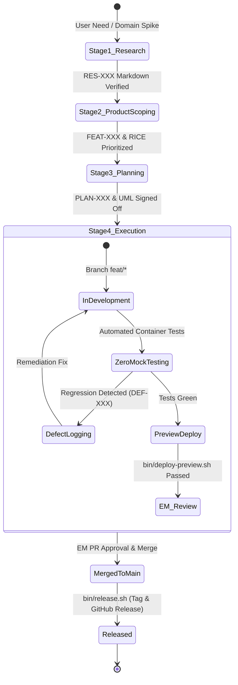
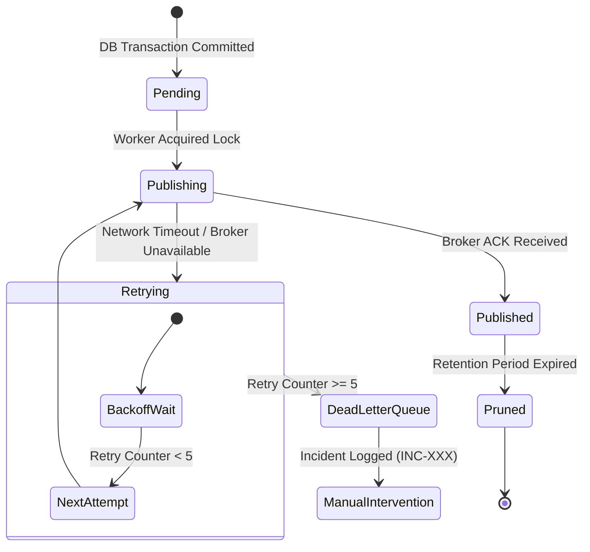
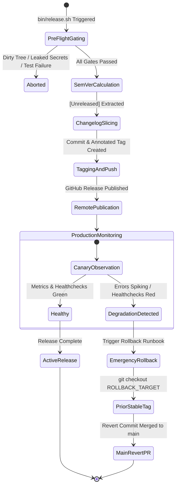

# Living State Machines & Lifecycle Specifications

> **Custodian**: System Architect & Full Stack Developer (`@architect`, `@fullstack-developer`)  
> **Status**: Living State Specification  
> **Last Synchronized**: 2026-10-21  

This document tracks all formal state machines, transition guards, terminal states, and concurrency lock invariants across the application.

---

## 1. Feature & Sprint Engineering Lifecycle (4-Stage Mandate)

---

## 2. Transactional Outbox Event Publishing Lifecycle

---

## 3. Production Release & Rollback Lifecycle

---

## 4. State Transition & Concurrency Invariants
1. **Deterministic State Guards**: An entity can never jump states without satisfying explicit guard conditions (e.g. no release without pre-flight green gates).
2. **Optimistic Locking**: Every mutable aggregate maintains an integer `version` field. State transitions verify `WHERE version = :current_version`.
3. **Dead-Letter Invariants**: Failed asynchronous transitions that exceed retry thresholds transition to `DeadLetterQueue` with an immutable failure payload and alert `@devops-sre`.

