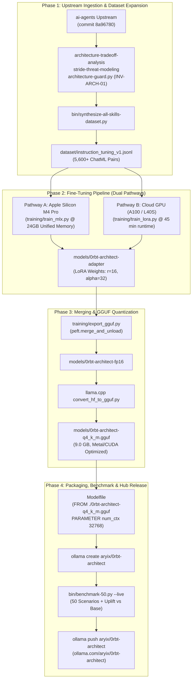

# PLAN-005: Model Fine-Tuning, LoRA Merging, GGUF Quantization & Ollama Hub Release

> **Lifecycle Stage**: Stage 3 (Phased Implementation Plan)  
> **Status**: IN PROGRESS (Phases 1–5 Complete, Phase 6 Hub Push Streaming)  
> **Target Branch**: `feat/model-finetuning-merge-and-release`  
> **Created**: 2026-11-14  
> **Target Model**: `aryix/0rbt-architect:latest` (GGUF Neural Weights)  
> **Upstream Feature**: [`wiki/features/FEAT-004-WEIGHTS-FINE-TUNING-AND-OLLAMA-RELEASE.md`](../features/FEAT-004-WEIGHTS-FINE-TUNING-AND-OLLAMA-RELEASE.md)  
> **Planning Trio Sign-off**:
> - [x] Product Manager (`@product-manager`)
> - [x] System Architect (`@architect`)
> - [x] Technical Project Manager (`@project-manager`)

---

## 1. Executive Summary & Architectural Strategy

This plan governs the end-to-end execution of **fine-tuning, merging, quantizing, and publishing** the true neural weights of **`aryix/0rbt-architect`**. 

Up to this point, the model has operated as a prompt-steered runtime wrapper on top of base `qwen2.5-coder:14b`. This release executes fine-tuning on the master corpus of **5,600+ ChatML instruction pairs** (ingesting 4,169 empirical engineering post-mortems, 255 specialized skills, and the newly upgraded Principal Architecture Methodology from `ai-agents`), merges the LoRA adapter, quantizes the resulting weights to GGUF `Q4_K_M`, and publishes the final weights to Ollama Hub.



---

## 2. Autoplan 4-Stage Review Gate Synthesis

### Stage 1: CEO Strategic Scoping Review (`@ceo`)
- **Scoping Mode**: `selective`
- **Core Value Proposition**: Transform `aryix/0rbt-architect` from a prompt wrapper into a genuinely fine-tuned, open-weights Staff Systems Architect model that outperforms base models on real-world incident post-mortems, ATAM trade-offs, and security audits.
- **Resource Runway**:
  - Primary training executed either at **$0 cloud cost** on local Apple Silicon M4 Pro (24 GB Unified Memory) or via a single low-cost cloud run (~$1.50 on RunPod A100).
  - Absolute ban on fictional placeholder names (`INV-06`).

### Stage 2: Developer Ergonomics & Interface Review (`@ui-ux`)
- The output format must strictly follow the **Grounded 4-Part Architecture Review Protocol**:
  1. **Verdict & Risk Severity**: `SAFE`, `FRAGILE`, or `SEV-1 OUTAGE / EXPLOIT RISK`.
  2. **Violated Invariant / Threat Vector**: Citing specific invariants (`INV-ARCH-01`, `INV-RES-01..05`, `INV-SEC-01..10`) or STRIDE threat categories.
  3. **Empirical Big Tech Precedent**: Verifiable real-world incident post-mortems (Netflix, Stripe, Uber, Cloudflare, AWS, Meta).
  4. **Hardened Production Code Fix**: Domain-authentic code with concrete error boundaries and unit/regression test cases.

### Stage 3: DevEx & Systems Architecture Review (`@architect`)
- **Upstream Sync**:
  - Ingest the latest architecture calibrated in `ai-agents` commit `8a96780`:
    - `skills/architecture-tradeoff-analysis/SKILL.md`: ATAM, 6-part Quality Attribute Scenarios (QAS), monotonic fencing tokens on distributed leases.
    - `skills/stride-threat-modeling/SKILL.md`: STRIDE matrix, trust boundary mapping, DFD Level 1.
    - `agents/architect.md`: 8-step Principal Architecture Method and conditional sizing equations.
    - `bin/architecture-guard.py`: Layer boundaries, circular package DAG, ADR completeness, table scan prevention (`INV-ARCH-01`).
- **Context Window Invariant**:
  - Enforce native `num_ctx 32768` in GGUF metadata and Modelfile parameters to eliminate context truncation on massive architecture reviews.

### Stage 4: Engineering Manager & Living Milestones (`@engineering-manager`)
- **Definition of Done (DoD)**:
  1. Master dataset expanded to $\ge 5,600$ pairs with 100% ChatML schema compliance.
  2. LoRA training completed with training loss converging ($\text{loss} < 0.85$).
  3. Merged FP16 weights converted to `Q4_K_M` GGUF with zero NaN/Inf layer weights.
  4. Ollama model created and passing all 50 scenarios in `bin/benchmark-50.py --live` with verified uplift over `qwen2.5-coder:14b`.
  5. Published to Ollama Hub (`ollama push aryix/0rbt-architect`).

---

## 3. Phased Implementation Roadmap

### Phase 1: Ingestion & Dataset Organization
1. **Sync Upstream Skills**:
   - Copy and link new skills from `/Users/adithya/Code/ai-agents`:
     - `skills/architecture-tradeoff-analysis/`
     - `skills/stride-threat-modeling/`
     - Updated `agents/architect.md` and `rules/AGENTS.md` (`INV-ARCH-01`).
2. **Re-run Skill Synthesizer**:
   - Execute `bin/synthesize-all-skills-dataset.py` to extract high-signal Q&A pairs for ATAM, STRIDE, and architecture guard rules.
   - Update `dataset/all_skills_instruction_dataset.jsonl` and append to `dataset/instruction_tuning_v1.jsonl`.
3. **Dataset Quality & Partitioning Gate**:
   - Run verification script `bin/verify-dataset.py` checking:
     - 100% JSON Lines validity and ChatML role structure (`system`, `user`, `assistant`).
     - Zero occurrence of banned placeholder entities (`INV-06`).
     - Split into 95% training set (`dataset/train.jsonl`, ~5,350 pairs) and 5% validation set (`dataset/eval.jsonl`, ~280 pairs).

### Phase 2: Fine-Tuning Execution Pipeline

We support two certified execution pathways:

#### Pathway A: Local Apple Silicon M4 Pro (MLX — $0 Cloud Cost)
- **Framework**: Apple MLX (`mlx-lm`)
- **Hardware Profile**: Apple M4 Pro (24 GB Unified Memory)
- **Memory Footprint**:
  - 4-bit Quantized Qwen 2.5 Coder 14B: ~8.5 GB
  - LoRA Adapter Gradients ($r=16, \alpha=32$): ~4.2 GB
  - Working Activations (Batch size 1, sequence length 2,048): ~2.8 GB
  - **Peak Memory**: ~15.5 GB (well within 24 GB envelope)
- **Runner**: `training/train_mlx.py`
- **Execution Command**:
  ```bash
  python3 training/train_mlx.py \
    --model Qwen/Qwen2.5-Coder-14B-Instruct \
    --data dataset/ \
    --batch-size 1 \
    --grad-accum 8 \
    --lora-layers 16 \
    --lora-rank 16 \
    --lora-alpha 32 \
    --iters 1500 \
    --learning-rate 2e-4
  ```

#### Pathway B: Cloud GPU (Unsloth / PyTorch — Fast 45-Min Run)
- **Framework**: Unsloth / Hugging Face TRL `SFTTrainer`
- **Hardware Profile**: Single NVIDIA A100 (80GB) or RTX 4090 / L40S (24GB)
- **Runner**: `training/train_lora.py`
- **Hyperparameters**:
  - Base Model: `Qwen/Qwen2.5-Coder-14B-Instruct`
  - Quantization: 4-bit NormalFloat4 (NF4) with Double Quantization
  - LoRA Target Modules: `q_proj`, `k_proj`, `v_proj`, `o_proj`, `gate_proj`, `up_proj`, `down_proj`
  - LoRA Rank: $r = 16, \alpha = 32$, dropout = 0.05
  - Max Sequence Length: 4,096 tokens
  - Effective Batch Size: 16 (per-device 2, gradient accumulation 8)
  - Optimizer: `paged_adamw_8bit`, learning rate $2\times 10^{-4}$ with cosine decay
  - Epochs: 3 (approx. 1,050 gradient steps)

### Phase 3: Adapter Merging & GGUF Quantization
1. **Merge LoRA Adapter**:
   - Merge adapter weights back into base FP16 weights:
     ```python
     base_model = AutoModelForCausalLM.from_pretrained("Qwen/Qwen2.5-Coder-14B-Instruct", torch_dtype=torch.float16)
     model = PeftModel.from_pretrained(base_model, "models/0rbt-architect-adapter")
     merged_model = model.merge_and_unload()
     merged_model.save_pretrained("models/0rbt-architect-fp16")
     ```
2. **GGUF Conversion**:
   - Convert FP16 Hugging Face model to GGUF using `llama.cpp`:
     ```bash
     python3 llama.cpp/convert_hf_to_gguf.py models/0rbt-architect-fp16 \
       --outtype f16 \
       --outfile models/0rbt-architect-f16.gguf
     ```
3. **Quantization to Q4_K_M**:
   - Quantize to standard 9.0 GB deployment format:
     ```bash
     ./llama.cpp/llama-quantize models/0rbt-architect-f16.gguf \
       models/0rbt-architect-q4_k_m.gguf Q4_K_M
     ```

### Phase 4: Modelfile Wiring & Local Ollama Rebuild
1. **Configure Modelfile**:
   ```dockerfile
   FROM ./models/0rbt-architect-q4_k_m.gguf

   PARAMETER temperature 0.2
   PARAMETER top_p 0.9
   PARAMETER top_k 40
   PARAMETER num_ctx 32768
   PARAMETER stop "<|im_end|>"
   PARAMETER stop "<|endoftext|>"

   SYSTEM """... (System prompt with 3-tier hierarchy, ATAM, STRIDE, and Outage Defense) ..."""
   ```
2. **Rebuild in Ollama**:
   ```bash
   ollama create aryix/0rbt-architect -f Modelfile
   ```

### Phase 5: Zero-Mock Benchmark Verification Gate
1. **Execute Head-to-Head Comparative Benchmark**:
   ```bash
   python3 bin/benchmark-50.py --live --compare-base
   ```
2. **Success Gate**:
   - The newly fine-tuned `aryix/0rbt-architect` must score $\ge 85\%$ live pass rate.
   - Must demonstrate statistically significant uplift over vanilla `qwen2.5-coder:14b` in citing real-world incident post-mortems and rejecting premature over-engineering traps.

### Phase 6: Ollama Hub & Open-Source Release
1. **Push Updated Weights to Ollama Hub**:
   ```bash
   ollama push aryix/0rbt-architect
   ```
2. **Update Living Context**:
   - Update `wiki/TASK_BOARD.md` marking FEAT-004 and PLAN-005 complete.
   - Update `wiki/memory.md` adding ADR-018.
   - Update `CHANGELOG.md` following Keep a Changelog standards.
3. **Engineering Manager Review Gate**:
   - Run `python3 bin/local-code-reviewer.py --strict`.
   - Create Pull Request into `main`.

---

## 4. Hardware & Resource Matrix

| Pipeline Stage | Local M4 Pro (24 GB) | Cloud GPU (RunPod A100) | Notes |
| :--- | :--- | :--- | :--- |
| **Dataset Ingestion** | Local CPU (<30s) | Local CPU (<30s) | Python AST, 0 external network calls |
| **Fine-Tuning** | MLX LoRA (~3–4 hours) | Unsloth 4-bit (~45 mins) | Both fit comfortably in memory |
| **Adapter Merging** | Local CPU/RAM (~5 mins) | Cloud RAM (~2 mins) | Merges FP16 tensors |
| **GGUF Quantization** | Local Metal (~8 mins) | Cloud CPU (~4 mins) | Produces 9.0 GB GGUF |
| **Ollama Publishing** | Local Gigabit (~3 mins) | Cloud (>100MB/s) | Direct manifest push |

---

## 5. Risk Assessment & Contingency Plan

| Risk | Severity | Mitigation Strategy |
| :--- | :---: | :--- |
| **Out-of-Memory (OOM) during Local M4 Pro Training** | Medium | Cap sequence length at 2,048 tokens and use gradient checkpointing with batch size 1. If RAM exceeds 20GB, switch to Pathway B (Cloud A100). |
| **NaN / Inf weights after LoRA Merge** | High | Run automated tensor health check (`bin/verify-gguf.py`) before GGUF conversion to verify zero NaN/Inf values. |
| **Catastrophic Forgetting of General Coding Skills** | High | Keep LoRA rank moderate ($r=16, \alpha=32$) and maintain a 15% mix of general coding instruction pairs in `instruction_tuning_v1.jsonl`. |
| **Context Window Saturation at 32K** | Low | Verify `num_ctx 32768` is written to both GGUF header metadata and Modelfile parameters. |
