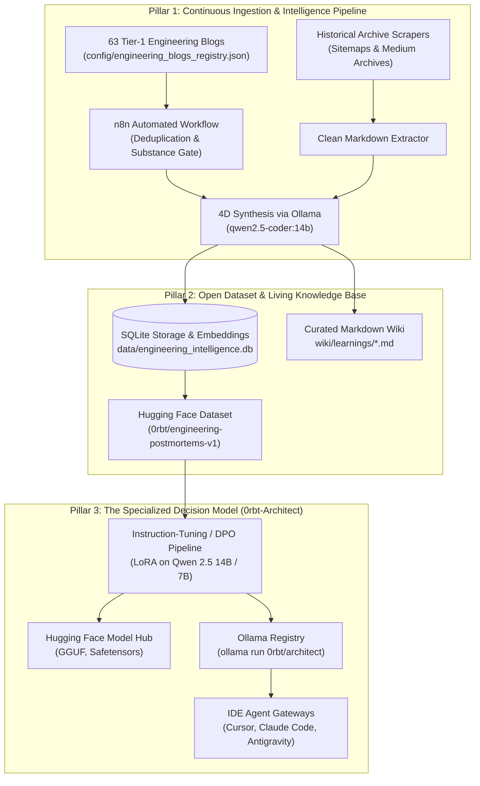

# Product Requirements Document (PRD): 0rbt — Open-Source Engineering Intelligence & AI Decision Engine

- **Project Name**: `0rbt` (Orbit)
- **Status**: Active Living Specification / Public Open-Source Initiative
- **Target Release**: `v1.0.0`
- **Owner**: Technical Founder & Community Lead (`@product-manager`, `@architect`, `@cto`)
- **Repository Target**: Open-Source GitHub Repository (`github.com/0rbt-ai/0rbt`)

---

## 1. Executive Summary & Vision

Today, LLM coding assistants (Cursor, Claude Code, GitHub Copilot, Windsurf) excel at writing isolated functions, but they **frequently make catastrophic architectural decisions** when designing distributed systems. They recommend premature microservices, fail to implement idempotency on payment endpoints, miss distributed locking race conditions, omit circuit breakers, and over-engineer simple startup backends with unneeded Kubernetes clusters.

Meanwhile, the world's greatest engineering teams (Netflix, Stripe, Uber, Google, Meta, GitHub, Datadog, Cloudflare, AWS) have already solved these exact architectural dilemmas and published their failures, post-mortems, and invariants in engineering blogs.

### The Mission of `0rbt`:
Build an end-to-end, open-source intelligence pipeline, curated dataset, and specialized AI model (**"0rbt-Architect"**) that ingests 10+ years of battle-tested engineering post-mortems to:
1. **Guide AI Agents**: Act as an upstream architectural reasoning engine / review gate that audits system designs before code is generated.
2. **Help Engineers Make Outage-Proof Decisions**: Provide concrete architectural trade-offs, system invariants, and small-scale downscaling playbooks ("Big Tech $\to$ Lean Startup").
3. **Be 100% Open-Source & Community-Driven**: Publish the tool, the curated dataset, and the model weights on GitHub, Hugging Face, and Ollama Hub for the global developer ecosystem.

---

## 2. The 3 Core Pillars of `0rbt`

---

## 3. Detailed Pillar Specifications

### Pillar 1: Ingestion & Intelligence Pipeline
- **Continuous Polling**: n8n workflow monitoring 63 verified RSS/Atom feeds every 3 hours with `ETag` and `If-Modified-Since` caching.
- **Historical Archive Scrapers**: Modular Python crawlers traversing company sitemaps and Medium archives to ingest 5+ years of historical post-mortems.
- **Substance & Deduplication Gates**:
  - `INV-BLOG-01`: Deterministic SHA-256 canonical URL hashing.
  - `INV-BLOG-02`: Minimum 200-word threshold; filters out job listings, conference marketing, and awards.
- **4-Dimensional Synthesis Matrix**:
  1. *LinkedIn Thought Leadership*: 3 contrarian/narrative/practical hooks + carousel slide outline.
  2. *Enterprise Architecture*: Problem, solution, invariants, and trade-offs.
  3. *Small-Scale Client Playbook*: "Big Tech $\to$ Lean Startup" translation (Postgres/Redis alternatives).
  4. *AI Invariants*: Automated rules proposed for agentic systems.

### Pillar 2: Curated Open Dataset
- **Format**: Parquet and SQLite containing thousands of verified engineering breakdowns.
- **Data Schema**:
  - `company`, `title`, `canonical_url`, `published_at`
  - `problem_statement`, `root_cause`, `solution_architecture`
  - `system_invariants`, `trade_offs`, `cost_implications`
  - `small_scale_alternative`, `actionable_checklist`
- **Distribution**: Published under Open Data Commons (ODC-By / CC-BY 4.0) on Hugging Face Datasets (`0rbt/engineering-postmortems`).

### Pillar 3: The Public Decision Model ("0rbt-Architect")
- **Phase A (Ollama Modelfile & Local RAG)**:
  - Packaged CLI (`bin/eng-intelligence.py`) enabling zero-token RAG over SQLite vector embeddings.
  - Custom Ollama Modelfile published to Ollama Hub (`0rbt/architect`) bundling the staff architect persona and retrieval instructions.
- **Phase B (Fine-Tuned Specialized Model)**:
  - Generate 5,000+ synthetic architectural instruction pairs:
    - *Input*: "A developer wants to implement credit card processing in a multi-region Node.js app."
    - *Reasoning*: Identifies race conditions, network partition hazards, double-charging risks.
    - *Output*: Prescribes two-phase idempotency locking (Stripe pattern), circuit breakers, and fallback queues.
  - Fine-tune Qwen 2.5 (7B and 14B) via LoRA/QLoRA on consumer GPUs (or cloud spot instances).
  - Quantize into 4-bit and 8-bit GGUF models and publish to Hugging Face and Ollama Hub.

---

## 4. Target Personas & User Stories

| Persona | Motivation | User Story |
| :--- | :--- | :--- |
| **AI Coding Agent** | Prevent architectural bugs | *As an AI coding agent, I want to query `0rbt/architect` before writing microservice code so that I enforce idempotency and circuit breakers automatically.* |
| **Staff Software Engineer** | System design review | *As a staff engineer, I want to search 10 years of post-mortems across Netflix, Stripe, and Uber to see how others solved high-cardinality telemetry or distributed locks.* |
| **Startup CTO / Consultant** | Avoid premature over-engineering | *As a startup CTO, I want to see how to achieve 85% of Big Tech resilience using Postgres and Redis without spending \$10k/mo on enterprise SaaS.* |
| **Open-Source Contributor** | Extend coverage | *As an open-source contributor, I want to add new engineering blog scrapers (e.g. Discord, Figma, Canva) and contribute evaluation benchmarks.* |

---

## 5. User Acceptance Criteria (UAC)

- [ ] **UAC-01 (Continuous Automation)**: n8n workflow executes every 3 hours with zero crashes, deduplicating articles via SHA-256 and storing 4D synthesis in SQLite.
- [ ] **UAC-02 (Local Zero-Token RAG CLI)**: Engineers can run `python3 bin/eng-intelligence.py ask "<question>"` and receive verified architecture guidance citing real company post-mortems in $<5$ seconds.
- [ ] **UAC-03 (Historical Archive Scraper)**: CLI supports crawling company sitemaps to ingest historical articles back to 2018.
- [ ] **UAC-04 (Dataset Export to Hugging Face)**: An automated script exports SQLite learnings into clean Parquet / JSONL format for Hugging Face Hub.
- [ ] **UAC-05 (Ollama Hub Modelfile)**: Community can run `ollama run 0rbt/architect` to query the specialized architectural model directly.
- [ ] **UAC-06 (Open-Source Repository Readiness)**: Comprehensive `README.md`, `CONTRIBUTING.md`, `LICENSE` (Apache 2.0 / MIT), and CI verification test suites.

---

## 6. Open Source Roadmap & Milestones

- **Milestone 1 (Foundations & Pipeline — Done)**:
  - 63-source registry (`config/engineering_blogs_registry.json`).
  - Production n8n workflow (`n8n/engineering_blogs_pipeline.json`).
  - Local SQLite DB (`data/engineering_intelligence.db`) and local Ollama RAG CLI (`bin/eng-intelligence.py`).
  - Seeded initial post-mortems (Netflix, Stripe, Uber).
- **Milestone 2 (Historical Crawlers & Dataset Scale)**:
  - Implement historical sitemap crawlers for top 25 companies.
  - Scale dataset to 2,000+ indexed post-mortems.
  - Export dataset to Hugging Face (`0rbt/engineering-postmortems-v1`).
- **Milestone 3 (Public Ollama Release & Community Repo)**:
  - Publish `0rbt` repository on GitHub with contributor guides.
  - Release `0rbt/architect` Modelfile on Ollama Hub.
- **Milestone 4 (Specialized Fine-Tuned Model)**:
  - Train LoRA fine-tune on Qwen 2.5 14B / 7B.
  - Benchmark architectural decision quality against GPT-4o and Claude 3.5 Sonnet using an open system design benchmark.
  - Publish GGUF weights to Hugging Face Hub.
