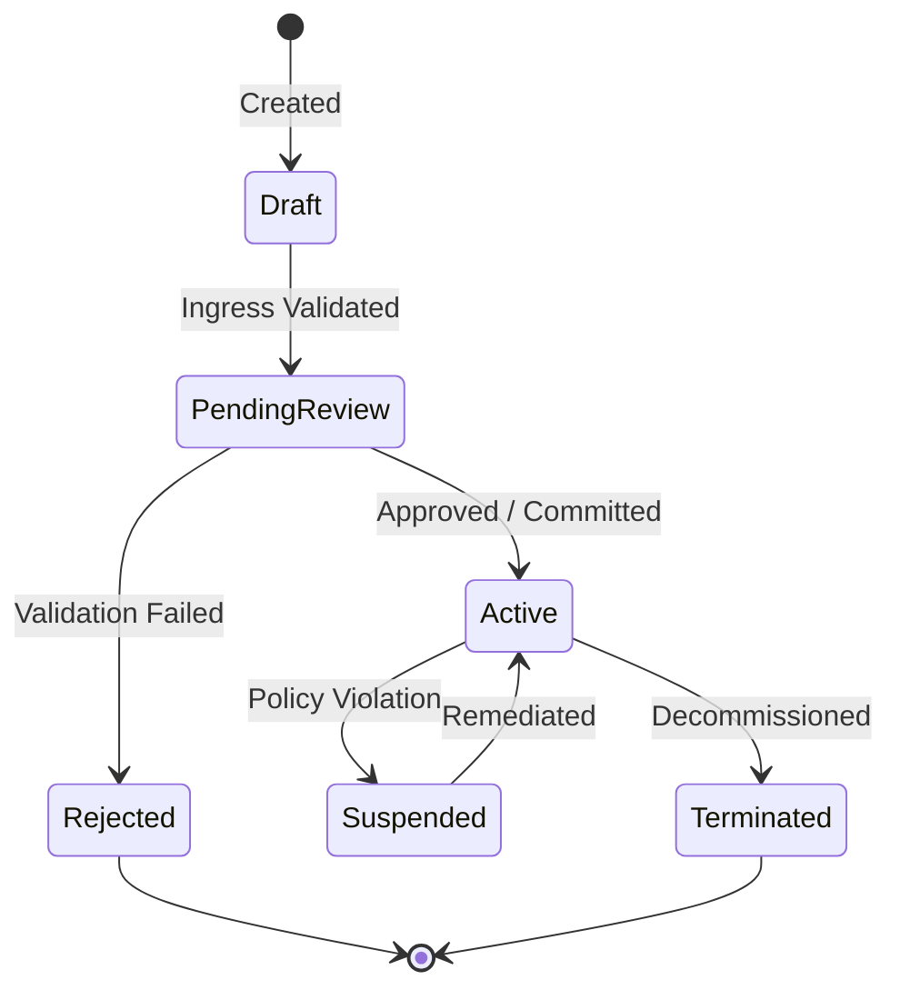

# Living State Machines & Lifecycle Specifications

> **Custodian**: System Architect & Full Stack Developer (`@architect`, `@fullstack-developer`)  
> **Status**: Living State Specification  
> **Last Synchronized**: {{DATE}}  

---

## 1. {{ENTITY_NAME}} Lifecycle State Machine

---

## 2. Transition Guards & Concurrency
- **Guard Validation**: Transitions enforce preconditions before state mutations.
- **Optimistic Locking**: Verified using integer `version` comparison (`WHERE version = :version`).
- **Audit Logging**: Every state change emits an audit event.

